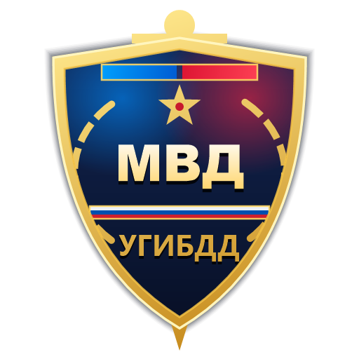
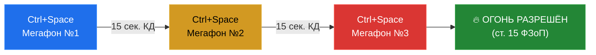

  

<h1 align="center">🚔 АХК УГИБДД NextGen • MTA Province</h1>

  <b>Ультимативный автономный RP-биндер нового поколения для сотрудников ГИБДД.</b> 
  <i>Бесплатная, открытая и функциональная альтернатива Province Helper с полной автоматизацией отчётов и процессуального кодекса.</i>

  
  
  
  
  

---

## 📑 Содержание

- [⚡ Почему NextGen лучше обычных биндеров?](#-почему-nextgen-лучше-обычных-биндеров)
- [🌟 Ключевой функционал](#-ключевой-функционал)
  - [1. 🚨 Диспетчер погони (Pursuit Watchdog)](#1--диспетчер-погони-pursuit-watchdog)
  - [2. 📊 Авто-Журнал нормы и «Online-протокол»](#2--авто-журнал-нормы-и-online-протокол)
  - [3. 📸 Умный Auto-Screen с /timestamp](#3--умный-auto-screen-с-timestamp)
  - [4. ➕ Визуальный Конструктор личных биндов](#4--визуальный-конструктор-личных-биндов)
  - [5. ⚖️ Калькулятор КоАП, УКРП и всех 25 статей ФЗоП](#5-️-интеллектуальный-калькулятор-коап-укрп-и-фзоп)
  - [6. 📤 Бэкап и мгновенный перенос профиля](#6--бэкап-и-перенос-профиля-backup--restore)
  - [7. 📦 Портативный Standalone EXE](#7--портативный-standalone-режим-single-exe)
- [⌨️ Таблица горячих клавиш](#-таблица-горячих-клавиш-по-умолчанию)
- [📘 Справочник быстрых команд ФЗоП](#-быстрые-команды-фзоп-в-чат)
- [🚀 Установка и первый запуск](#-установка-и-быстрый-старт)
- [⚙️ Важные технические требования](#-важные-настройки-в-игре)

---

## ⚡ Почему NextGen лучше обычных биндеров?

| Функция | Старые АХК двухлетней давности | Платный Province Helper | 🚔 АХК УГИБДД NextGen |
| :--- | :---: | :---: | :---: |
| **Стоимость** | Бесплатно | 💵 Платная подписка | **Бесплатно и навсегда** |
| **Автономность** | Требует установку AHK v1 | Свой лаунчер | **Портативный Single .EXE** |
| **Защита от флуда в мегафон (15 сек)** | ❌ Нет | ⚠️ Частично | **✅ Аппаратный КД (ст. 15 ФЗоП)** |
| **Таймер 3 минут погони вне города** | ❌ Нет | ⚠️ Текстом | **✅ Живой HUD + звуковые алерты** |
| **Скриншоты с `/timestamp` в отчёт** | ❌ Вручную | ✅ Есть | **✅ Автоматически с защитой F12** |
| **Генератор отчёта для форума в 1 клик** | ❌ Вручную | ⚠️ Только свой формат | **✅ Готовый BB-код под онлайн-протокол** |
| **Все 25 статей ФЗоП (ред. 2026)** | ❌ Устарели | ⚠️ Выборочно | **✅ Полная база с авто-отыгровкой** |
| **Калькулятор штрафов с лимитом 50k** | ❌ Нет | ✅ Есть | **✅ Интерактивный (`Alt+F1`)** |
| **Свои бинды прямо из интерфейса** | ❌ Только через код | ⚠️ Ограниченно | **✅ Конструктор с переменными** |
| **Резервная копия настроек и клавиш** | ❌ Нет | ❌ Привязка к аккаунту | **✅ Экспорт / Импорт в `.ini`** |

---

## 🌟 Ключевой функционал

### 1. 🚨 Диспетчер погони (Pursuit Watchdog)
> [!IMPORTANT]
> Согласно ст. 15 Федерального Закона «О полиции», перед открытием огня по колёсам ТС сотрудник обязан выдвинуть не менее **трёх требований об остановке с интервалом не менее 15 секунд**. Нарушение карается выговором или увольнением.

Скрипт полностью автоматизирует этот регламент на **одну клавишу (`Ctrl + Space` или команду `/погоня`)**:
- 🟢 **1-е нажатие**: Мегафон №1 («*Водитель, принимаем крайнее правое положение...*»). Включается отсчёт 15 секунд и таймер 3 минут погони вне города.
- 🟡 **2-е нажатие**: Мегафон №2 («*Повторяю, водитель, примите вправо... В противном случае откроем огонь!*»). Скрипт не позволит отправить флуд раньше 15 секунд, выводя предупреждение: `⏳ Подождите ещё X сек.!`.
- 🔴 **3-е нажатие**: Мегафон №3 («*Останавливайтесь! В случае отказа откроем огонь!*»).
- 💥 **4-е нажатие**: Звуковой сигнал и оповещение: `⚠️ ТРЕБОВАНИЯ ВЫПОЛНЕНЫ! ОГОНЬ ПО КОЛЕСАМ РАЗРЕШЁН!`.
- 🏁 **Сброс погони**: горячая клавиша `Alt + Space` или команда `/погонястоп`.

---

### 2. 📊 Авто-Журнал нормы и «Online-протокол»
Забудьте о ручном заполнении форума в субботу вечером!
- Вкладка **«📊 Журнал нормы»** накапливает все ваши действия за смену: штрафы КоАП, аресты в КПЗ, аннулированные права и радиодоклады.
- Кнопка **«📋 Скопировать отчёт для форума»** генерирует аккуратный BB-код со всеми вашими регалиями (звание, отдел, жетон, позывной, точные суммы штрафов, дата и подробный список фиксаций).
- Кнопка **«📁 Экспорт журнала (CSV)»** выгружает данные в Excel-таблицу.

---

### 3. 📸 Умный Auto-Screen с `/timestamp`
> [!TIP]
> В MTA Province наличие `/timestamp` на скриншоте является обязательным требованием для доказательств в жалобе или онлайн-протоколе.

- При любом ключевом процессуальном действии скрипт мгновенно отправляет в консоль команду `/timestamp`, делает игровой снимок (`F12`) и сигнализирует в трей.
- Защита клавиши `F12`: системный стоп-биндер временно изолируется во время скриншота, исключая прерывание текущей RP-отыгровки.
- Включается и выключается в один клик на вкладке *«⌨️ Клавиши»*.

---

### 4. ➕ Визуальный Конструктор личных биндов
Создавайте свои собственные команды прямо из GUI-интерфейса без правки кода скрипта:
- Поддержка запуска по **команде чата** (`/пост`, `/тонировка`) или по **хоткею** (`!Numpad1`).
- Поддержка динамических переменных в тексте:
  - `{Fio}` — Фамилия и инициалы сотрудника
  - `{Rank}` — Специальное звание
  - `{Znak}` — Нагрудный знак
  - `{Otdel}` — Отдел / Спецрота
  - `{Callsign}` — Позывной
  - `{Id}` — ID нарушителя (автоматически перехватывается из лога игры)
- Персональная задержка между строками (в мс).

---

### 5. ⚖️ Интеллектуальный калькулятор КоАП, УКРП и ФЗоП
Вызывается по горячей клавише **`Alt + F1`** или команде **/фзоп**:
- Интерактивный поиск с моментальной фильтрацией по ключевым словам.
- Автоматический расчёт срока лишения ВУ и суммы штрафа (с ограничением в **50 000 руб.** по правилам сервера).
- Кнопка **«Озвучить статьи»**: сотрудник строго по регламенту зачитывает нарушителю основание привлечения к ответственности перед оформлением документов.

---

### 6. 📤 Бэкап и перенос профиля (Backup / Restore)
- В окне **«📋 Анкета»** доступны кнопки:
  - **`📤 Экспорт (бэкап)`** — сохраняет весь профиль, более 40 настроенных клавиш и пользовательские бинды в один внешний файл `.ini`.
  - **`📥 Импорт профиля`** — восстанавливает все ваши настройки в 1 клик на любом новом компьютере.

---

### 7. 📦 Портативный Standalone-режим (Single EXE)
- Скомпилированный файл **`АХК УГИБДД.exe`** содержит в себе аудиодорожку рации `1.mp3` и векторную иконку `ahkgibdd.ico`.
- Не требует установки сторонних интерпретаторов — скачал, запустил и поехал в патруль!

---

## ⌨️ Таблица горячих клавиш по умолчанию

| Клавиша | Описание действия | Категория |
| :--- | :--- | :--- |
| `Ctrl + Space` | 🚨 **Умный мегафон погони** (1 -> 2 -> 3 -> Санкция на огонь) | СГУ и Погоня |
| `Alt + Space` | 🏁 **Сброс режима погони и таймеров** | СГУ и Погоня |
| `Alt + F1` | ⚖️ **Интерактивный калькулятор статей, КоАП и ФЗоП** | Утилиты |
| `Alt + H` | ⏱️ **Показать / скрыть HUD-индикатор дежурства** | Утилиты |
| `F12` | ⛔ **Экстренная остановка любой отыгровки или лекции** | Система |
| `Ctrl + 1` | 📋 Показать главное окно биндера | Интерфейс |
| `Ctrl + 2` | 🪪 Требование предъявить документы (ст. 7 ФЗоП) | Процессуальное |
| `Ctrl + 3` | 🔍 Взять и изучить документы водителя | Процессуальное |
| `Ctrl + 4` | 🤝 Вернуть проверенные документы гражданину | Процессуальное |
| `Ctrl + 5` | 📝 Составить протокол задержания | Задержание |
| `Ctrl + 6` | 📜 Составить административный протокол | Оформление |
| `Alt + 6` | ✍️ Передать протокол на подпись (1) / забрать (2) | Оформление |
| `Ctrl + 7` | 📻 Выдать розыск со звуком рации (`/su`) | Оформление |
| `Alt + 7` | 💳 Выписать штраф нарушителю (`/tsu`) | Оформление |
| `Alt + F7` | 🚫 Аннулировать водительское удостоверение (`/takecarlic`) | Оформление |
| `Ctrl + 0` | 🚔 Передать задержанного конвоиру в КПЗ (`/arrest`) | Задержание |
| `Ctrl + =` | ⛓️ Надеть наручники и пристегнуть к двери патрульки | Задержание |
| `Ctrl + Del` | 🔓 Снять наручники и вручить копию протокола | Задержание |
| `Alt + 3` | 📱 Достать служебный планшет КПК | КПК |
| `Alt + 4` | 🔍 Пробить гражданина по базе КПК (`/skan`) | КПК |
| `Alt + 5` | 📱 Убрать служебный планшет КПК | КПК |
| `Ctrl + Insert` | 🎙️ Включить голосовую рацию (`/fracvoice 1`) | Рация |
| `Ctrl + Home` | 🔇 Режим прослушивания рации (`/fracvoice 2`) | Рация |
| `Alt + R` | 🔄 Перезагрузить скрипт (Reload) | Система |
| `End` | ⏸️ Приостановить работу АХК (Пауза) | Система |

> [!NOTE]
> Абсолютно любую клавишу можно легко переназначить в главном окне на вкладке **«⌨️ Клавиши»**!

---

## 📘 Быстрые команды ФЗоП в чат

Все 25 статей актуального Федерального Закона «О полиции» можно зачитать гражданину прямой командой в игровой чат:

<b>Развернуть полный список команд ФЗоП (нажмите, чтобы открыть)</b>

 

| Команда | Статья ФЗоП | Краткое содержание статьи |
| :--- | :--- | :--- |
| `/фзопобр` | ст. 4 п. 4.4 | Обращение к гражданину: назвать должность, звание, фамилию и цель |
| `/фзопдок` | ст. 7 п. 4.7 | Требование предъявить документы, удостоверяющие личность и ВУ |
| `/фзопост` | ст. 7 п. 4.7.1 | Основания для законной остановки транспортного средства |
| `/фзопосм` | ст. 8 п. 4.8 | Визуальный осмотр транспортного средства и груза без вскрытия |
| `/фзопдосм` | ст. 9 п. 4.9 | Досмотр автомобиля, багажника и личных вещей с протоколом |
| `/фзопориент` | ст. 10 п. 4.10 | Сверка лица гражданина и номерных знаков авто по ориентировке |
| `/фзопрасп` | ст. 11 п. 4.11 | Законное требование покинуть салон автомобиля |
| `/фзоплиш` | ст. 12 п. 4.12 | Основания для аннулирования водительского удостоверения |
| `/фзопогран` | ст. 13 п. 4.13 | Оцепление участков местности, блокпосты и спецпланы |
| `/фзопфиз` | ст. 14 п. 5.14 | Применение физической силы и боевых приемов борьбы |
| `/фзопспец` | ст. 14 п. 5.14 | Применение спецсредств: дубинка, наручники, электрошокер |
| `/фзопоружие` | ст. 15 п. 5.15 | Применение огнестрельного оружия на поражение ТС |
| `/фзоппредупр`| ст. 16 п. 5.16 | Обязанность предупреждения о намерении применить оружие |
| `/фзопправила` | ст. 17 п. 5.17 | Запреты на открытие огня (скопление людей, тяжелое оружие) |
| `/фзопгарант` | ст. 18 п. 6.18 | Презумпция законности действий сотрудника полиции |
| `/фзопстрой` | ст. 19–20 | Регламент построения и сдачи еженедельного онлайн-протокола |

---

## 🚀 Установка и быстрый старт

1. **Скачайте готовый биндер**:
   - Перейдите в раздел репозитория и сохраните файл [**`АХК УГИБДД.exe`**](https://github.com/Polaney/AHK_Province/raw/main/АХК%20УГИБДД.exe).
2. **Запустите программу** от имени **Администратора**.
3. **Заполните анкету**:
   - Нажмите кнопку **«📋 Анкета»** в нижней панели.
   - Укажите ваши ФИО, город управления (Приволжск, Мирный или Невский), специальное звание и нагрудный знак.
   - Нажмите **«💾 Сохранить»**.

---

## ⚙️ Важные настройки в игре

> [!WARNING]
> Для безупречной и безошибочной работы биндера без ложных открытий инвентаря или телефона:

1. **Назначение клавиши чата**: В настройках управления GTA SA / MTA Province назначьте открытие чата (или дополнительную клавишу чата) на **`F6`**.
2. **Путь к логам**: Убедитесь, что в анкете указан корректный путь к папке `MTA\logs` (где находится `console.log`) — это требуется для автоматического перехвата ID нарушителей и вызовов по рации.
3. **Права доступа**: Запускайте биндер от имени Администратора, чтобы горячие клавиши стабильно перехватывались поверх окна игры.

---

  <b>Служим закону — служим народу! 🇷🇺</b> 
  <i>Разработано с душой для сотрудников УГИБДД MTA Province.</i>

