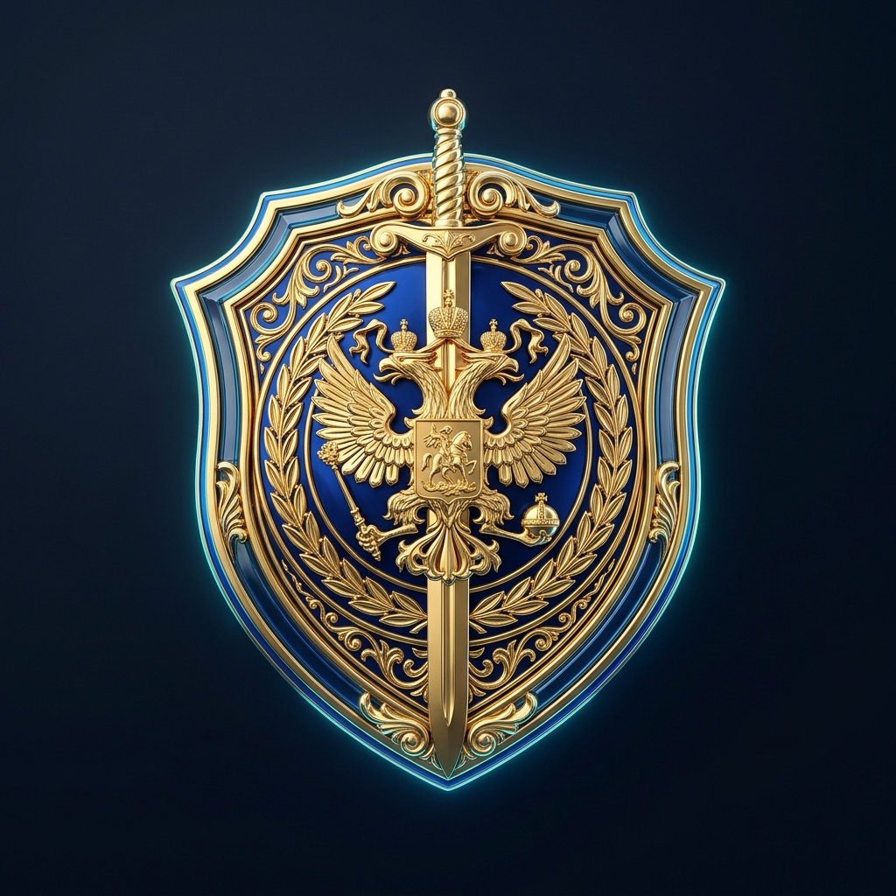
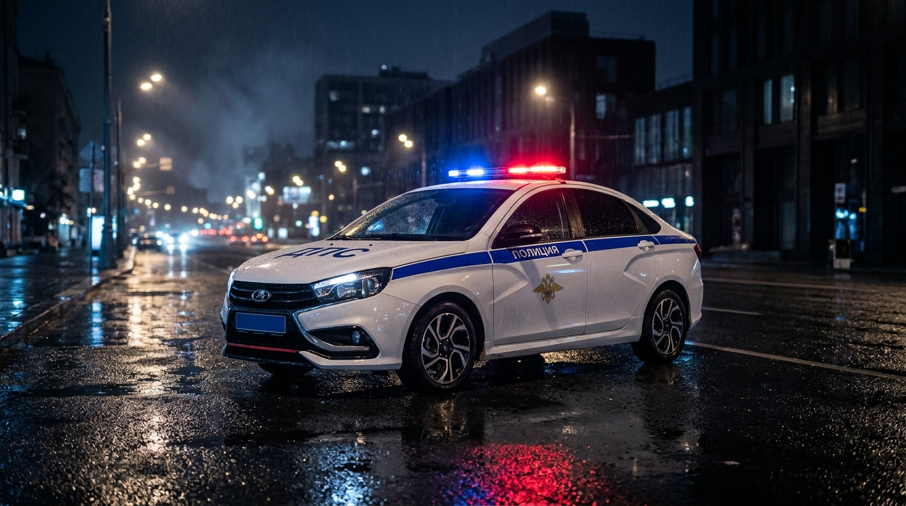

  

<h1 align="center">🚔 АХК УГИБДД МВД • Fluent Police Glass Edition</h1>

  <b>Премиальный автономный бортовой терминал и RP-биндер нового поколения для сотрудников ГИБДД на проекте MTA Province.</b> 
  <i>Разработан на базе нативного движка AutoHotkey v1.1 с современным интерфейсом Fluent Glass (HTML5 / CSS3 / JS ActiveX), тактическим HUD-оверлеем и защитой от античита.</i>

  
  
  
  
  

---

  

---

## 📑 Содержание

- [✨ Что нового в версии v2.4.0 (Fluent Police Glass)?](#-что-нового-в-версии-v240-fluent-police-glass)
- [⚡ Сравнение с обычными биндерами](#-сравнение-с-обычными-биндерами)
- [🌟 Ключевой функционал](#-ключевой-функционал)
  - [1. 💎 Премиальный бортовой терминал Fluent Police Glass](#1--премиальный-бортовой-терминал-fluent-police-glass)
  - [2. 🧮 Встроенный интерактивный калькулятор КоАП и УК](#2--встроенный-интерактивный-калькулятор-коап-и-ук)
  - [3. 🚨 Диспетчер погони и мегафонов (ст. 15 ФЗоП)](#3--диспетчер-погони-и-мегафонов-ст-15-фзоп)
  - [4. 🎯 Тактический HUD-оверлей поверх игры (Alt+H)](#4--тактический-hud-оверлей-поверх-игры-alth)
  - [5. 📊 Авто-Журнал нормы и генератор отчёта на форум](#5--авто-журнал-нормы-и-генератор-отчёта-на-форум)
  - [6. 🔗 Единый портал ссылок и материалов МВД](#6--единый-портал-ссылок-и-материалов-мвд)
  - [7. 📸 Умный Auto-Screen с /timestamp](#7--умный-auto-screen-с-timestamp)
  - [8. 🖥️ Адаптивность под экраны 1366x768 и ноутбуки](#8-️-адаптивность-под-экраны-1366x768-и-ноутбуки)
- [⌨️ Основные горячие клавиши по умолчанию](#-основные-горячие-клавиши-по-умолчанию)
- [🚀 Установка и запуск](#-установка-и-запуск)
- [⚙️ Рекомендованные настройки в игре](#-рекомендованные-настройки-в-игре)

---

## ✨ Что нового в версии v2.4.0 (Fluent Police Glass)?

* **Полный редизайн**: главное окно биндера переведено на высокоскоростной движок в стиле тёмно-сапфирового матового стекла (*Windows 11 Fluent Glass*) с неоновой подсветкой спецсигналов ДПС.
* **Вшитая графика**: широкоформатный арт ночного перехватчика ДПС, 3D-герб УГИБДД МВД и голографическая телеметрия патруля упакованы прямо внутрь `.exe`.
* **Встроенный Калькулятор КоАП/УК**: модальное окно расчёта штрафов прямо в интерфейсе по нажатию `Alt+F1` с автоматической проверкой лимита 100.000 руб., формированием остатка и срока лишения прав.
* **Единый портал ссылок МВД**: быстрый переход ко всем разделам форума (Приволжск, Мирный, Невский), законам и карте скоростных камер.
* **Адаптивность под любые экраны**: автоматическое масштабирование и центрирование окна для мониторов с разрешением `1366×768` и ноутбуков.
* **Двойной режим работы**: мгновенное переключение в 1 клик между новым **Fluent Glass UI** и привычным классическим меню (`🎛️ Классика`).

---

## ⚡ Сравнение с обычными биндерами

| Возможность | Старые текстовые АХК | Платный Helper | 🚔 АХК УГИБДД Fluent Glass |
| :--- | :---: | :---: | :---: |
| **Стоимость** | Бесплатно | 💵 Ежемесячная подписка | **Бесплатно и навсегда** |
| **Интерфейс** | Серое окно Windows 98 | Обычное окно | **💎 Fluent Glassmorphism (HTML5/CSS3)** |
| **Потребление RAM** | ~15 МБ | ~250 МБ | **~25 МБ (легче любого браузера)** |
| **Защита от античита MTA 1.6** | ❌ Кики за флуд | ⚠️ Бывают сбои | **✅ Оптимизированный SendInput + F8** |
| **Аппаратный КД мегафона (15 сек)** | ❌ Нет | ⚠️ Частично | **✅ Контроль ст. 15 ФЗоП + звуковые алерты** |
| **Тактический игровой HUD** | ❌ Нет | ⚠️ Текстом | **✅ Drag&Drop оверлей поверх игры** |
| **Калькулятор штрафов (до 100к)** | ❌ Нет | ✅ Есть | **✅ Интерактивный планшет (`Alt+F1`)** |
| **База статей с живым поиском** | ❌ Нет | ⚠️ Выборочно | **✅ Все 165 статей КоАП, УК, ФЗоП, ПДД** |
| **Готовый отчёт для форума в 1 клик** | ❌ Вручную | ⚠️ Свой формат | **✅ Полный BB-код с подсчётом баллов** |
| **Автономный запуск** | Требует AutoHotkey | Сторонний софт | **✅ Single Portable .EXE (всё в одном)** |

---

## 🌟 Ключевой функционал

### 1. 💎 Премиальный бортовой терминал Fluent Police Glass
Интерфейс спроектирован так, чтобы офицер чувствовал себя за настоящим бортовым компьютером патрульного экипажа:
- **Удостоверение сотрудника**: карточка офицера в сайдбаре отображает ваше текущее звание, ФИО, отдел, нагрудный жетон и позывной. Нажатие на `⚙️ Анкета` открывает стеклянное окно редактирования профиля без перезапуска скрипта.
- **Живая телеметрия на дашборде**: каждую секунду обновляются таймеры докладов в рацию, статус погони, КД мегафонов, время смены и набранные баллы нормы.
- **Интерактивная шпаргалка**: клик по любой команде или горячей клавише моментально копирует её в буфер обмена.

  

---

### 2. 🧮 Встроенный интерактивный калькулятор КоАП и УК
Больше не нужно держать открытыми десять вкладок браузера с кодексами:
- Вызывается горячей клавишей **`Alt + F1`** или кнопкой в верхней шапке.
- **Живой поиск по 165 статьям**: достаточно ввести номер (`5.1`) или ключевое слово (`тонировка`, `красный`, `оружие`).
- **Автоматический расчёт суммы**: скрипт сам суммирует штрафы и форматирует команду по регламенту: `/tsu <ID> 30000 5.1+5.3 КоАП`.
- **Контроль лимита 100.000 руб.**: при превышении лимита автоматически создаётся команда остатка (`/tsu <ID> 45000 12.5 КоАП`) с возможностью скопировать или отправить её в чат второй строкой.
- **Автоматическое лишение ВУ**: распознаёт статьи с лишением прав, рассчитывает срок (1, 2, 3 года или переобучение) и генерирует команду `/takecarlic`.
- **Кнопка «Отыграть и /tsu»**: сама сворачивает окно, отыгрывает КПК через `/me` и `/do` и вводит штраф нарушителю.

---

### 3. 🚨 Диспетчер погони и мегафонов (ст. 15 ФЗоП)
> [!IMPORTANT]
> Согласно ст. 15 Федерального Закона «О полиции», перед открытием огня по колёсам ТС сотрудник обязан выдвинуть не менее **трёх требований об остановке с интервалом не менее 15 секунд**. Нарушение карается выговором или увольнением.

Биндер полностью берёт контроль на одну клавишу **`Ctrl + Space`** (или команду `/погоня`):
1. **1-е нажатие**: Мегафон №1 («*Водитель, принимаем крайнее правое положение и останавливаемся!*»). Стартует отсчёт 15 секунд и 3-минутный таймер погони вне города.
2. **2-е нажатие**: Мегафон №2. Если прошло менее 15 секунд, скрипт блокирует спам и выдаёт алерт: `⏳ Подождите ещё X сек.!`.
3. **3-е нажатие**: Мегафон №3 («*Останавливайтесь! В противном случае откроем огонь!*»).
4. **4-е нажатие**: Звуковой сигнал и оповещение: `🔥 ТРЕБОВАНИЯ ВЫПОЛНЕНЫ! ОГОНЬ ПО КОЛЁСАМ РАЗРЕШЁН!`.
* **Сброс погони**: горячая клавиша `Alt + Space` или команда `/погонястоп`.

---

### 4. 🎯 Тактический HUD-оверлей поверх игры (Alt+H)
Компактный полупрозрачный HUD-дисплей отображается прямо поверх игры MTA Province:
- **Шкала погони**: статус требований (1/3, 2/3, 3/3), индикатор 15-секундного КД и статус открытия огня.
- **Таймер докладов патруля/поста**: прогресс-бар отсчитывает 15 минут патруля (`/п1`) или 20 минут поста (`/пост1`), звуковыми сигналами напоминая о необходимости доклада в рацию за 2 минуты и во время дедлайна.
- **Счётчик смены и баллов нормы**: в реальном времени считает проведённое на дежурстве время и баллы для отчёта (Штраф = 1 балл, Арест = 3 балла, Лишение = 2 балла, Доклад = 1 балл).
- **Свободное перемещение (Drag & Drop)**: нажмите **`Alt + Shift + H`**, зажмите панель левой кнопкой мыши и переместите в любое удобное место экрана. Позиция сохраняется навсегда!

---

### 5. 📊 Авто-Журнал нормы и генератор отчёта на форум
Забудьте о ручной сортировке десятков скриншотов в конце недели:
- Все ваши штрафы, аресты, доклады и лишения прав автоматически заносятся в базу с точным временем.
- Нажатие кнопки **«📋 Скопировать отчёт для форума»** моментально формирует готовый красивый BB-код с вашим званием, отделом, датой, итоговой суммой выписанных штрафов и нумерованным списком нарушителей.
- Поддерживается экспорт журнала в таблицу Excel (`.csv`).

---

### 6. 🔗 Единый портал ссылок и материалов МВД
Встроенное окно полезных ресурсов открывается по кнопке **`🔗 Ссылки МВД`**:
- Прямой переход на официальный форум МВД и разделы УГИБДД всех городов (Приволжск, Мирный, Невский).
- Ссылки на актуальный текст законов: ФЗоП, КоАП, УК РП, ПДД.
- Интерактивная карта расположения всех скоростных радаров и камер.
- Памятка по 6 режимам проблесковых маячков и СГУ.

---

### 7. 📸 Умный Auto-Screen с /timestamp
- При выписке штрафа, аресте или подаче мегафона скрипт моментально отправляет `/timestamp` и производит фиксацию клавишей `F12`.
- Клавиша прерывания отыгровок (`F12`) аппаратно изолируется во время снимка, предотвращая случайный сброс бинда.
- Функция включается и выключается в один клик прямо на дашборде.

---

### 8. 🖥️ Адаптивность под экраны 1366x768 и ноутбуки
Терминал автоматически считывает текущее разрешение монитора:
- На экранах с высотой $\le 768$ пикселей окно запускается в компактном режиме `1180×670`, центрируется на экране и не перекрывает панель задач Windows.
- Модальное окно калькулятора штрафов адаптирует высоту таблицы, благодаря чему все кнопки отыгровки и итоговые суммы всегда остаются на виду без необходимости бесконечного скроллинга.

---

## ⌨️ Основные горячие клавиши по умолчанию

> Все горячие клавиши можно в любой момент переназначить на вкладке **«⌨️ Клавиши»** или кликом по значку клавиши в терминале!

| Горячая клавиша | Назначение / Отыгровка |
| :--- | :--- |
| **`Alt + F1`** | **Открыть Интерактивный Калькулятор КоАП / УК** |
| **`Alt + H`** | **Показать / скрыть тактический игровой HUD** |
| **`Alt + Shift + H`** | **Режим перемещения HUD мышкой (Drag & Drop)** |
| **`Ctrl + Space`** | **Умный мегафон погони (15 сек. КД по ст. 15 ФЗоП)** |
| **`Alt + Space`** | **Сброс статуса погони и таймеров** |
| **`F11`** | **Быстрый перезапуск биндера (Reload)** |
| **`F12`** | **Экстренная отмена текущей отыгровки (Stop)** |
| **`Numpad 1`** | Приветствие гражданина и представление по форме |
| **`Numpad 2`** | Просьба передать документы водителя |
| **`Numpad 3`** | Взять документы на проверку |
| **`Numpad 4`** | Вернуть документы гражданину |
| **`Numpad 5`** | Составление протокола об административном нарушении |
| **`Numpad 6`** | Передача задержанного конвоиру в КПЗ (`/arrest`) |
| **`Numpad 7`** | Быстрая выдача розыска через рацию (`/su`) |
| **`Numpad 8`** | Выписать штраф нарушителю (`/tsu`) |
| **`Numpad 9`** | Аннулировать водительское удостоверение (`/takecarlic`) |
| **`Alt + Numpad 1`** | Открыть наручники |
| **`Alt + Numpad 2`** | Надеть наручники на гражданина |

---

## 🚀 Установка и запуск

1. Перейдите во вкладку [Releases](https://github.com/Polaney/AHK_Province/releases) репозитория.
2. Скачайте файл **`АХК УГИБДД.exe`**.
3. Запустите файл от имени администратора.
4. При первом запуске в левом сайдбаре нажмите **`⚙️ Анкета`**, укажите ваше имя, звание, отдел, жетон и позывной, после чего нажмите **`💾 Сохранить изменения`**.
5. Заходите в игру MTA Province и заступайте на службу!

---

## ⚙️ Рекомендованные настройки в игре

* **Раскладка клавиатуры**: скрипт автоматически переключает раскладку на русскую перед отправкой текста, но для стабильности рекомендуется держать язык ввода по умолчанию — Русский.
* **Клавиша F8**: в настройках MTA клавиша открытия консоли должна быть стандартной (`F8`).
* **Чат F6**: чат игры должен открываться по стандартной клавише `F6` или `T`.
* **UAC / Права администратора**: если бинды не нажимаются внутри игры, запускайте биндер правой кнопкой мыши -> *«Запуск от имени администратора»*.

---

  <b>УГИБДД МВД Республики Провинция • Служба, Честь и Безопасность на дорогах! 🚔</b>

